<p align="center">
  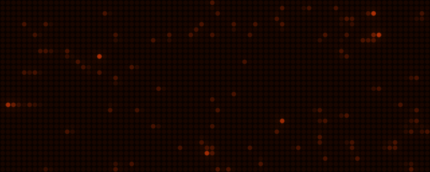
</p>

# glowdots

[](https://github.com/ztaylor/glowdots/actions/workflows/ci.yml)
[](https://crates.io/crates/glowdots)
[](https://docs.rs/glowdots)
[](LICENSE)

A 1990s pinball dot matrix display, for anything you want to show.

glowdots recreates the orange plasma displays of the Williams, Bally, and Data East pinball machines of the 1990s. Every dot is drawn to look like them: round dots in 4 shades, bright centers, a soft halo, and a quick fade as they go dark. Write scenes in Rust, feed them JSON, and play them in a window, in a web page, or full screen on a Raspberry Pi.

**[Try the live demo](https://ztaylor.github.io/glowdots/)**. It runs the real engine in your browser, compiled to WebAssembly. Change the glass, the color, and the time of day, or edit the JSON and watch the display follow.

https://github.com/user-attachments/assets/f0b7fdbf-8823-4aef-813a-585f90afb7a7

Every frame of this video, and its soundtrack, comes from glowdots itself (`cargo run --release --bin promo`).

## Scenes

The example scenes are each a pattern you can take for your own. They run on built-in sample data.

| | |
|:-:|:-:|
| 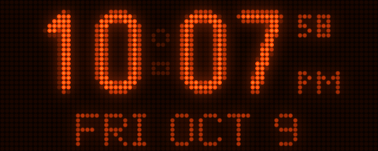<br>**Clock**: big anti-aliased digits that roll over | 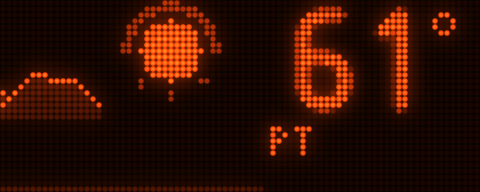<br>**Weather**: a live sky beside pages that type in |
| 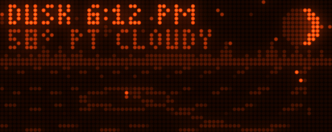<br>**Lake**: a whole landscape drawn dot by dot from a few numbers | 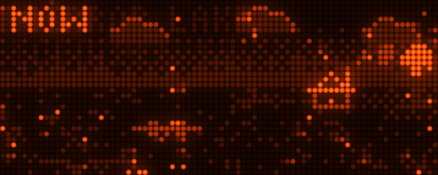<br>**Lake in winter**: the same scene with other data |
| 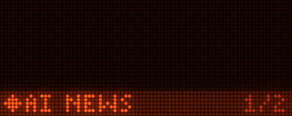<br>**News board**: split-flap headlines and a TV lower third | 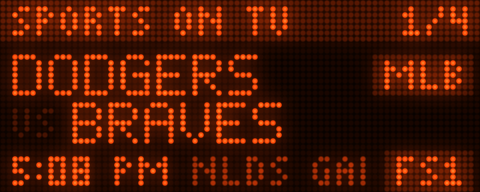<br>**Sports**: cards from a JSON list, the easiest place to start |
| 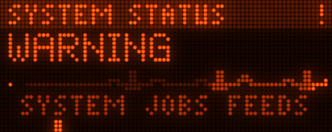<br>**Status board**: a heart monitor and a pinball lamp test | 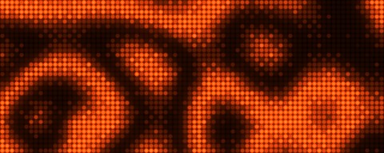<br>**Demoscene**: starfield, plasma, a dot tunnel, and a torus |

## Quick start

You need [Rust](https://rustup.rs). Then:

```sh
git clone https://github.com/ztaylor/glowdots
cd glowdots
cargo run --release
```

A window opens and plays every example scene. Press the arrow keys or click the right or left half to move between scenes, F for full screen, and Esc to quit. Some options:

```sh
cargo run --release -- --scene lake --now "2026-10-09 21:40"   # the lake at night
cargo run --release -- --glass led                              # an LED panel instead of plasma
cargo run --release -- --data ~/my-feeds                        # your own JSON, over the samples
cargo run --release -- --scene news --gif news.gif --steady     # record a GIF for your README
cargo run --release -- --help
```

## Your first scene

A scene draws one frame at a time into a grid of dots. This is a whole program:

```rust
use glowdots::font::{REGULAR, SMALL};
use glowdots::{Context, Deck, Frame, MAX, Player, Scene, Size};

struct Hello;

impl Scene for Hello {
    fn name(&self) -> &str {
        "hello"
    }

    fn update(&mut self, cx: &Context, out: &mut Frame) {
        REGULAR.draw_centered(out, "HELLO, WORLD", 6, MAX);
        SMALL.draw_centered(out, &cx.now.format("%-I:%M:%S %p").to_string(), 17, 2);
        let x = (cx.t * 40.0) as i32 % out.w(); // cx.t: seconds into the scene
        out.set(x, 27, MAX);
    }

    fn duration(&self) -> f32 {
        60.0
    }
}

fn main() -> anyhow::Result<()> {
    let deck = Deck::new(Size::WPC, vec![Box::new(Hello)])?;
    glowdots::app::run(Player::new(deck), Default::default())
}
```

Run it with `cargo run --example hello`. Shades go from 0 (off) to `MAX` (3), like the Williams games. Add `glowdots = "0.1"` to your own project's `Cargo.toml` to start fresh, or add the example scenes too with `glowdots-scenes = "0.1"`.

[Writing scenes](docs/scenes.md) covers sprites, fonts, dithering, transitions, taps and keys, and the patterns the example scenes use.

## Put your data on it

Scenes read JSON feeds. On a real display they are files in a folder, written by anything: a cron job with `curl`, a script, a home automation hub, or an AI agent. A scene reads its file again each time it comes around.

```json
{"items": [
  {"title": "Pinball league night", "venue": "The Silverball Arcade", "time": "7:30 PM", "category": "Games"}
]}
```

Save that as `events.json` in a folder, run `cargo run --release -- --data that-folder --scene events`, and it is on the display. If the JSON is broken, the display says which line. [Feeding data](docs/feeds.md) has the shape each example scene reads, and how to read feeds in your own scenes.

## Make it look like yours

The defaults are the classic look. Everything about it can change.

| | |
|:-:|:-:|
| 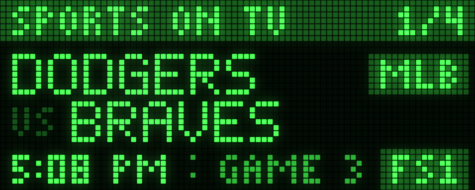<br>LED glass, green | 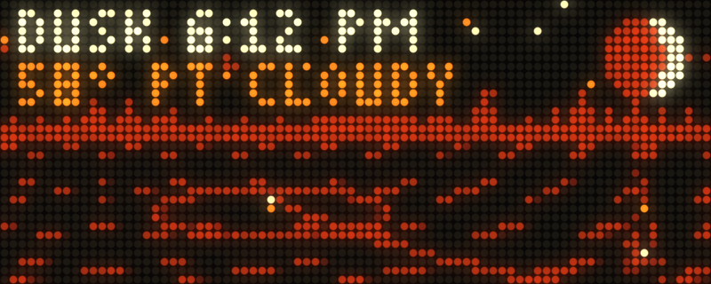<br>A heat palette |
| 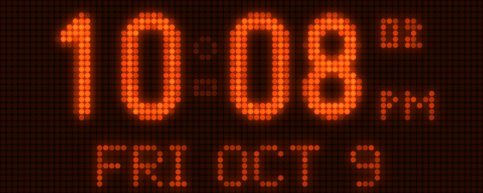<br>Worn plasma glass | 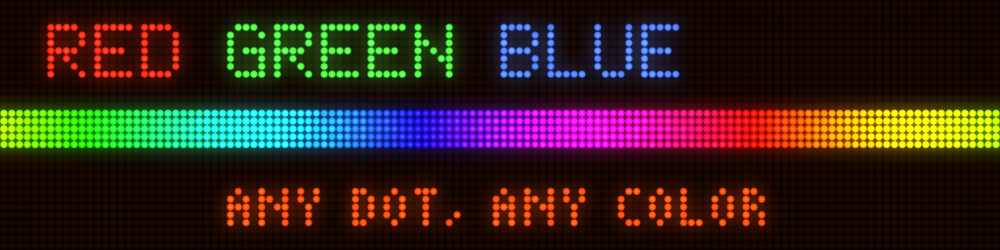<br>A color for any dot |

```rust
let deck = Deck::new(Size::new(192, 64), scenes)?   // any panel size
    .with_shades(16);                               // up to 16 shades
let mut player = Player::new(deck).with_glass(Glass::LED);
player.look = Some(Look::heat());                   // or Look::GREEN, Look::palette(&[...])
```

[Looks and glass](docs/looks.md) lists every glass setting, palettes, per-dot color, and panel sizes.

## Run it on a Raspberry Pi

glowdots runs full screen on a Raspberry Pi with no desktop, straight to the panel through SDL's KMSDRM driver, and starts at boot with systemd. It began as a wall display on a Pi 5 with the 5 inch Touch Display 2. [Raspberry Pi](docs/raspberry-pi.md) walks through it.

## Put it on a web page

The `web` feature plays a deck in a canvas with WebGL 2. The [live demo](https://ztaylor.github.io/glowdots/) is built that way, from `web/`. [On the web](docs/web.md) shows how to build it and how to put your own deck on a page.

## What's here

| | |
|---|---|
| [`crates/glowdots`](crates/glowdots) | The engine: frames, sprites, fonts, the deck and transitions, the renderer, and the window, Pi, and web players. |
| [`crates/glowdots-scenes`](crates/glowdots-scenes) | The example scenes and their sample feeds. |
| [`showcase`](showcase) | The `glowdots` program that plays them; `media`, which makes the pictures in this README; and `promo`, which renders the launch video. |
| [`web`](web) | The live demo page. |
| [`docs`](docs) | Guides. The API reference is on [docs.rs](https://docs.rs/glowdots). |

## License

MIT. See [LICENSE](LICENSE).

glowdots is a tribute to the pinball machines of the 1990s. It is not affiliated with Williams, Bally, Data East, Stern, or Sega, whose names are used only to describe the style.
